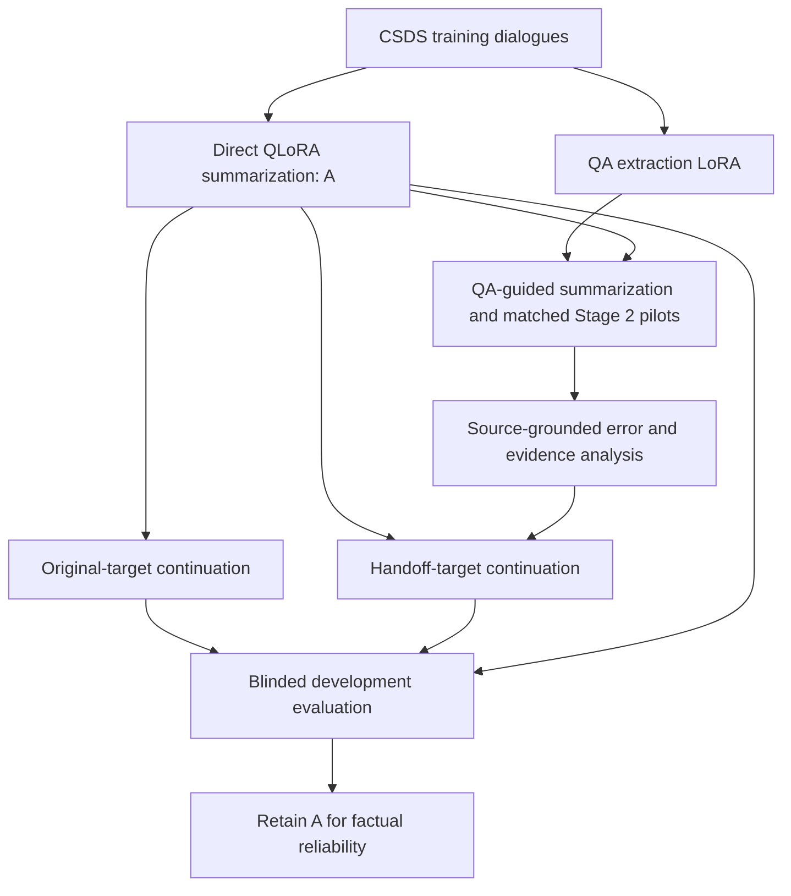

# Factual Consistency in Chinese Customer-Service Dialogue Summarization

An experimental NLP project investigating whether question–answer (QA) evidence and handoff-oriented supervision improve factual reliability in Chinese customer-service summaries.

**Stack:** Python · PyTorch · Qwen3-4B-Instruct-2507 · Hugging Face Transformers · PEFT · 4-bit QLoRA

## Research question

Can intermediate factual QA or a different summary training target improve the usefulness of customer-service summaries without introducing unsupported statements? Customer-service handoffs require the model to distinguish requests, promises, confirmed actions, and unresolved outcomes. A longer summary is not necessarily a more reliable summary.

## Main finding

Handoff-oriented targets increased key-fact coverage but reduced the proportion of source-supported claims in a controlled continuation-training experiment. The original direct summarizer (A) was retained for factual reliability rather than selecting the more comprehensive but less faithful candidate.

| Model | Key-fact coverage | Source-supported claims |
|---|---:|---:|
| A: original direct summarizer (retained) | 94/239 (39.33%) | 249/252 (98.81%) |
| Original: continued training with original targets | 84/239 (35.15%) | 233/236 (98.73%) |
| Handoff: continued training with handoff targets | 119/239 (49.79%) | 359/397 (90.43%) |

**Handoff vs. Original:** +14.64 percentage points of key-fact coverage, −8.30 points of source-supported claims (rounded). This comparison uses matched training inputs and conditions. A is a separate operational baseline, not the matched continuation-training control.

The evaluation covers 60 previously unseen development dialogues and 239 pre-established key facts. Three model variants produced 180 summaries; identical outputs for the same dialogue were reviewed once, leaving 169 distinct summaries. A single AI reviewer performed blinded source-grounded assessment. These are development-set results, not official test-set results or independent human validation. The public aggregate counts are transcribed from the project report; raw annotations and the full scoring report remain in the private archive. See [results](results/README.md) and [methodology](docs/methodology.md).

## Research workflow



## Repository layout

The original Python paths are preserved to avoid breaking imports and experiment fingerprints.

| Location | Purpose |
|---|---|
| `src/` | Baselines, SFT, QA extraction, QA repair, paired Stage 2 training and validation |
| `csds_handoff128/` | Matched original/handoff continuation training and blinded evaluation |
| `csds_handoff_pilot/` | Earlier target-construction pilot |
| `validate_*.py` | Source-grounded diagnostics, revision and unseen-development evaluation |
| `tests/` | CPU-only contract checks |
| `examples/` | Fictional input dialogue for demonstration |
| `results/` | Aggregate counts and a reproducible metric table |
| `docs/` | Methodology, reproduction and limitations |

## Quick start (CPU, no data or model download)

From the repository root, with Python 3.12 recommended:

```bash
python -m unittest discover -s tests -v
PYTHONPATH=src python tests/test_study_contract.py
python scripts/demo_summary.py --prompt-only
python scripts/show_results.py
```

For the direct standalone contract test, use `PYTHONPATH=src python tests/test_study_contract.py` on Linux/macOS. The prompt-only demonstration prints the actual direct-summary input for a fictional dialogue, not a generated prediction.

## GPU inference with the retained adapter

Install a CUDA-compatible PyTorch environment and the dependencies in `requirements.txt` (see [reproduction](docs/reproduction.md) before selecting package versions). The existing inference uses single-device CUDA, BF16 and 4-bit NF4 with double quantization; the Apple Silicon/MPS path has not been implemented or tested.

Restore the exact base model and your trained A adapter locally:

```text
models/Qwen3-4B-Instruct-2507/
outputs/qlora_sft/final_adapter/
```

Then run:

```bash
python scripts/demo_summary.py
```

Use `--input path/to/dialogue.json` for another source-only CSDS-format dialogue. The demo reuses the original Stage 2 direct prompt and greedy generation (384 new tokens); it does not train anything. The weights are intentionally not distributed here. GPU inference for this release wrapper has not been run in the packaging environment.

## Reproducibility and scope

- The code for earlier QA-based experiments is retained for research context. The completed matched Stage 2 experiment is the `pilot512` study; no completed full matched pair is claimed.
- The final 128-dialogue experiment fixes starting adapter, training dialogues, input prompt, optimizer steps and decoding between Original and Handoff. Target content differs, so supervised token counts can differ.
- Training data, derived QA, private predictions, reviewer files, adapters and base weights are excluded. Exact historical reproduction needs the author's original private artifacts and recorded package versions. This is a code-and-results portfolio release, not a standalone reproduction bundle.
- No official test-set performance, independent human validation, or GPU latency/VRAM improvement is claimed. A prospective evaluation and independent human review would strengthen the evidence.
- The AI-assisted target drafting and single-AI blinded assessment are limitations of the experiment.

See [reproduction instructions](docs/reproduction.md) for entry points and artifact requirements.

## Data and model attribution

- Dataset: CSDS (Chinese Customer Service Dialogue Summarization), obtain from the original project: https://github.com/xiaolinAndy/CSDS . Review its terms before use or redistribution.
- Base model: Qwen3-4B-Instruct-2507, https://huggingface.co/Qwen/Qwen3-4B-Instruct-2507 . Follow its upstream model terms.
- This repository does not redistribute either dataset or model weights. No open-source license is asserted for the project code until the author confirms applicable ownership and licensing terms.
